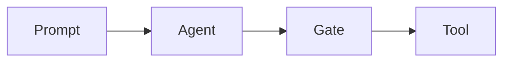
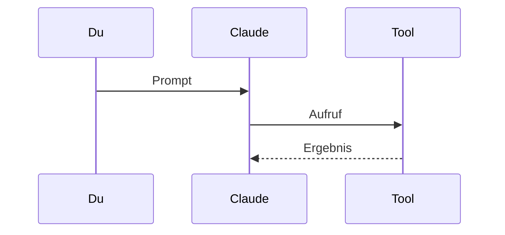
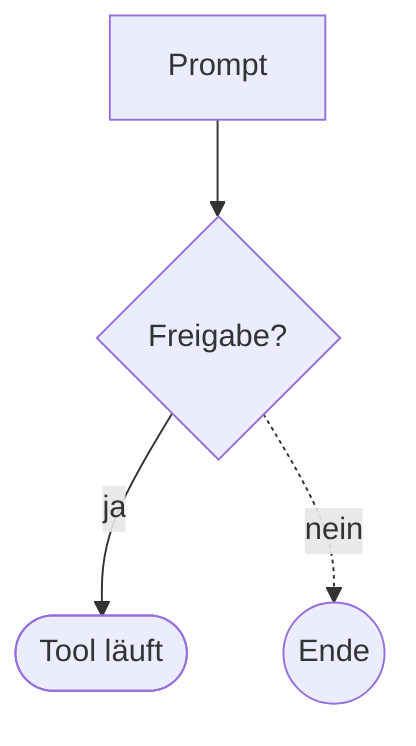
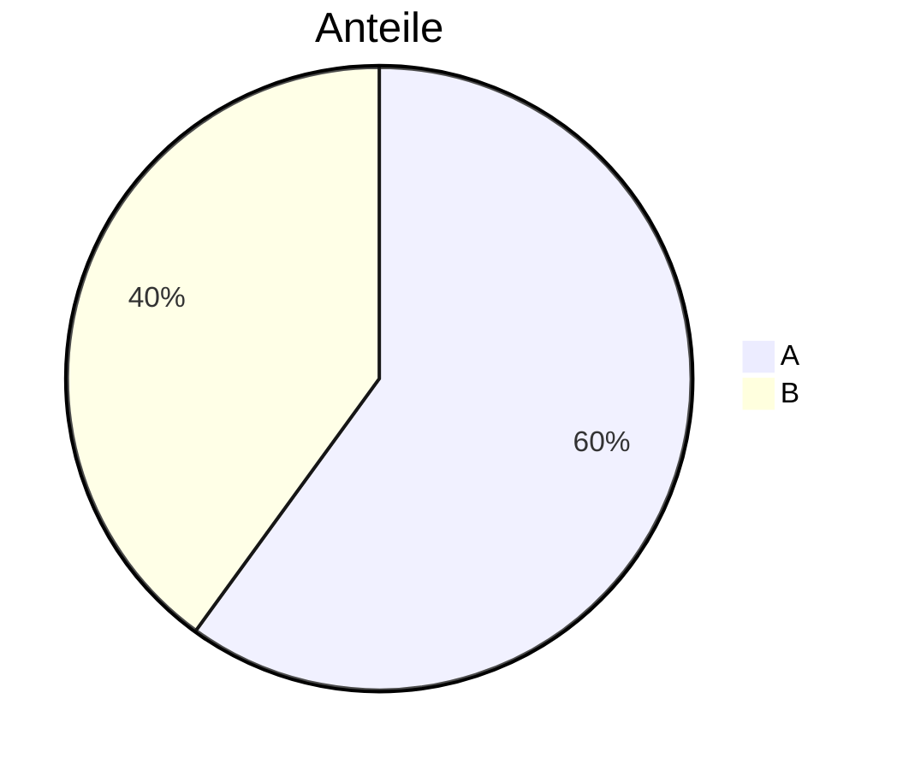

# Cockpit · Demo aller stylbaren Elemente

Zwei Ebenen: die **Komponenten**, die ein Mod über `ui.render` zeichnen kann, und die **Markdown-Elemente** in Antworten und Command-Ausgaben. Die Zählung steht in der gedimmten Info-Zeile mit dem Tenvan-Symbol unter dieser Ausgabe.

<!-- KOMPONENTEN -->

### Arbeits- und Dauerzeile

Farben aus den Dark-Tokens des Design-Systems. Ein eigenes Muster für Ladezustände gibt es dort noch nicht, darum nur die Farbrollen. Schalter: Einstellungen → Chat → „Arbeits- und Dauerzeile“.

| Zeile | Teil | Token | Farbe |
| --- | --- | --- | --- |
| Arbeitszeile | ⠋ Fragt an | `--text-secondary` | `#aeb2ba` |
| Arbeitszeile | ⠋ Denkt nach | `--text-link` | `#8eadfd` |
| Arbeitszeile | ⠋ Antwortet | `--status-success-fg` | `#89c958` |
| Arbeitszeile | ⠋ Werkzeug | `--status-warning` | `#e8b641` |
| Arbeitszeile | Schritt (z. B. „Creating notes.md“) | `--text-secondary` | `#aeb2ba` |
| Arbeitszeile | · 12s · 3 Tool-Calls · 1 Edits | `--text-muted` | `#8c929c` |
| Arbeitszeile | · 1 Fehler | `--status-error-fg` | `#fa6e6e` |
| Dauerzeile (nur Terminal) | ✓ Fertig | `--status-success-fg` | `#89c958` |
| Dauerzeile (nur Terminal) | nach 1m 4s | `--text-muted` | `#8c929c` |

So sehen sie aus: `⠋ Denkt nach  Creating notes.md · 12s · 3 Tool-Calls` und `✓ Fertig nach 1m 4s`. Die echte Arbeitszeile siehst du beim nächsten Prompt unter der laufenden Antwort.

## Markdown-Elemente

### Überschriften

# H1 Überschrift
## H2 Überschrift
### H3 Überschrift
#### H4 Überschrift
##### H5 Überschrift
###### H6 Überschrift

### Text

Normaler Absatz mit **fett**, *kursiv*, ***fett und kursiv***, ~~durchgestrichen~~, `Inline-Code` und einem harten  
Zeilenumbruch. Tastenkürzel: <kbd>Strg</kbd> + <kbd>C</kbd>.

Reiner Absatz für die Hervorhebungen (Einstellung „Hervorhebungen“): Version 0.7.0 ändert 3 Dateien, darunter hooks/skins.ts mit 42 % mehr Tests

### Zitat

> Einfaches Zitat.
>
> > Verschachteltes Zitat mit **Hervorhebung**.

### Hinweis-Blöcke (GitHub-Alerts)

> [!NOTE]
> Hinweis.

> [!TIP]
> Tipp.

> [!IMPORTANT]
> Wichtig.

> [!WARNING]
> Warnung.

> [!CAUTION]
> Vorsicht.

### Listen

- Ungeordnet
  - Verschachtelt
    - Dritte Ebene
- Zweiter Punkt

1. Geordnet
2. Zweiter Schritt
   1. Unterschritt

- [x] Aufgabe erledigt
- [ ] Aufgabe offen

### Trennlinie

---

### Tabelle

| Links | Mitte | Rechts |
| :--- | :---: | ---: |
| Text | `Code` | 1.234,56 |
| **fett** | *kursiv* | 7 |

### Codeblöcke

```ts
export const greet = (name: string): string => `Hallo ${name}`
```

```python
def greet(name: str) -> str:
    return f"Hallo {name}"
```

```json
{ "name": "tenvan-cc", "version": "0.6.0" }
```

```
Codeblock ohne Sprache
```

### Diff

```diff
@@ -1,3 +1,3 @@
 const keep = true
- const limit = 10
+ const limit = LOG_MAX
```

### Shell

```bash
git status --short
```

```powershell
Get-ChildItem -Recurse -Filter *.tsx
```

### Mermaid







Nicht unterstützt, bleibt Markdown:



### Mathe

Inline: $E = mc^2$

$$
\text{Takt} = \text{Verbrauch} - \text{verstrichene Zeit}
$$

$$
\mu = \frac{1}{n} \sum_{i=1}^{n} x_i \leq \sqrt{x_1^2 + x_2^2}
$$

### Links

[Markdown-Link](https://docs.anthropic.com/en/docs/claude-code) · <https://github.com/hellosverre/claude-skins> · Datei-Link [register.tsx](hooks/register.tsx)

### Fußnote

Text mit Fußnote[^1].

[^1]: Die Fußnote.

### Aufklappbar

<details>
<summary>Details anzeigen</summary>

Versteckter Inhalt.

</details>
