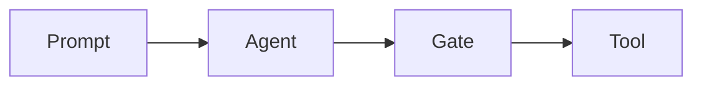
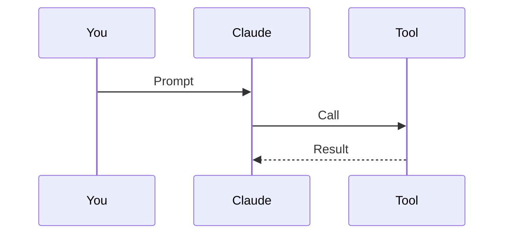
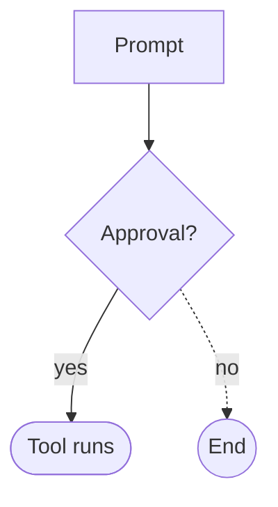
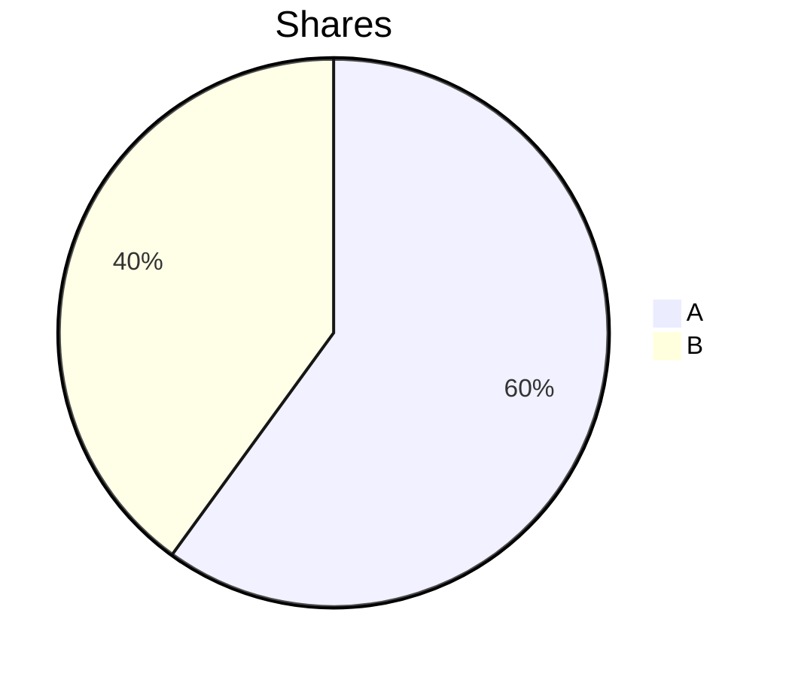

# Cockpit · Demo of all stylable elements

Two layers: the **components** a mod can draw via `ui.render`, and the **Markdown elements** in replies and command output. The count is in the dim info line with the orgaMAX symbol below this output.

<!-- KOMPONENTEN -->

### Working and duration line

Colors from the dark tokens of the orgaMAX design system. It has no pattern for loading states yet, so only the color roles are used. Toggle: Settings → Chat → "Working and duration line".

| Line | Part | Token | Color |
| --- | --- | --- | --- |
| Working line | ⠋ Requesting | `--text-secondary` | `#aeb2ba` |
| Working line | ⠋ Thinking | `--text-link` (`--om-blue-400`) | `#8eadfd` |
| Working line | ⠋ Responding | `--status-success-fg` | `#89c958` |
| Working line | ⠋ Tool | `--status-warning` | `#e8b641` |
| Working line | Step (e.g. "Creating notes.md") | `--text-secondary` | `#aeb2ba` |
| Working line | · 12s · 3 tool calls · 1 edits | `--text-muted` | `#8c929c` |
| Working line | · 1 errors | `--status-error-fg` | `#fa6e6e` |
| Duration line (terminal only) | ✓ Done | `--status-success-fg` | `#89c958` |
| Duration line (terminal only) | after 1m 4s | `--text-muted` | `#8c929c` |

This is how they look: `⠋ Thinking  Creating notes.md · 12s · 3 tool calls` and `✓ Done after 1m 4s`. You will see the real working line under the running reply on your next prompt.

## Markdown elements

### Headings

# H1 heading
## H2 heading
### H3 heading
#### H4 heading
##### H5 heading
###### H6 heading

### Text

Plain paragraph with **bold**, *italic*, ***bold and italic***, ~~strikethrough~~, `inline code` and a hard  
line break. Shortcut: <kbd>Ctrl</kbd> + <kbd>C</kbd>.

Plain paragraph for highlights (setting "Highlights"): version 0.7.0 changes 3 files, among them hooks/skins.ts with 42 % more tests

### Quote

> Simple quote.
>
> > Nested quote with **emphasis**.

### Callouts (GitHub alerts)

> [!NOTE]
> Note.

> [!TIP]
> Tip.

> [!IMPORTANT]
> Important.

> [!WARNING]
> Warning.

> [!CAUTION]
> Caution.

### Lists

- Unordered
  - Nested
    - Third level
- Second item

1. Ordered
2. Second step
   1. Sub-step

- [x] Task done
- [ ] Task open

### Horizontal rule

---

### Table

| Left | Center | Right |
| :--- | :---: | ---: |
| Text | `Code` | 1,234.56 |
| **bold** | *italic* | 7 |

### Code blocks

```ts
export const greet = (name: string): string => `Hello ${name}`
```

```python
def greet(name: str) -> str:
    return f"Hello {name}"
```

```json
{ "name": "orgamax-cockpit", "version": "0.6.0" }
```

```
Code block without a language
```

### Diff

```diff
@@ -1,3 +1,3 @@
 const keep = true
- const limit = 10
+ const limit = LOG_MAX
```

### Shell

```bash
git status --short
```

```powershell
Get-ChildItem -Recurse -Filter *.tsx
```

### Mermaid







Not supported, stays Markdown:



### Math

Inline: $E = mc^2$

$$
\text{Pace} = \text{Usage} - \text{elapsed time}
$$

$$
\mu = \frac{1}{n} \sum_{i=1}^{n} x_i \leq \sqrt{x_1^2 + x_2^2}
$$

### Links

[Markdown link](https://docs.anthropic.com/en/docs/claude-code) · <https://github.com/hellosverre/claude-skins> · File link [register.tsx](hooks/register.tsx)

### Footnote

Text with a footnote[^1].

[^1]: The footnote.

### Collapsible

<details>
<summary>Show details</summary>

Hidden content.

</details>
